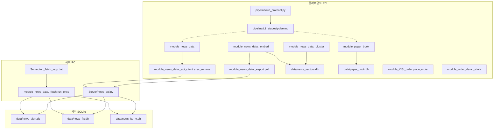
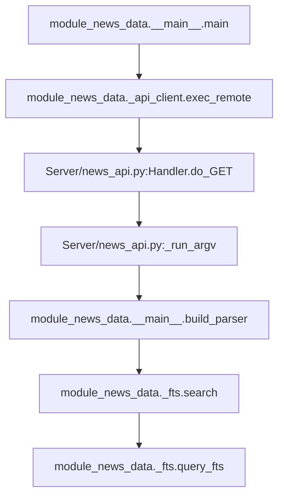

# DeGaJaFinance

Python tools collect and analyze financial news, disclosures, prices, and fund flows; an LLM agent reads staged instructions and uses the modules, with collection and search on a server and heavy analysis on a client.

## 한 줄 소개

금융 데이터 수집과 분석을 Python 모듈로 제공하고, LLM 에이전트가 단계별 지시를 읽으며 이를 사용하는 작업 환경이다.

## 무엇을 왜 만들었나

뉴스 수집, 시세 조회, 차트 해석, 리포트 검산을 개별 도구로 나누고 CLI와 Python 함수로 사용할 수 있게 구성했다. 기준 커밋은 `3226943`이며, Git 추적 파일에서 `__init__.py`를 가진 최상위 `module_*` 패키지는 23개이다.

코드에 기록된 문제는 분석 기능 자체에만 있지 않다. 원격 조회를 기능마다 따로 구현하면 실행 경로가 갈리고, 모든 단계의 지시를 한꺼번에 제공하면 앞선 맥락을 놓치기 쉽다고 주석에 적혀 있다. 같은 파서를 서버와 CLI에서 재사용하고, 필요한 단계의 지시만 조합하는 코드가 이 문제에 대응한다.

`CLAUDE.md`에는 같은 기능을 한 곳에만 정의해 가져다 쓴다는 원칙이 적혀 있으며, 서버가 CLI의 `DB_READ_CMDS`와 `build_parser`를 가져오는 구현에서 이를 확인할 수 있다.
결론은 관측값, 출처와 신선도를 채운 뒤 내리고 모듈은 결정론 데이터와 분석만 제공하며 판단은 상위 에이전트에 남긴다는 원칙도 적혀 있다. 이에 대응해 `cluster_day`는 기준 날짜, 기사 수, 출처와 근거 URL을 반환하고, 사건의 방향에 대한 판단은 제공하지 않는다.
수집 서버와 무거운 계산 클라이언트를 분리한다는 원칙은 `_encode` 내부의 모델 import와 `DB_READ_CMDS`에서 임베딩 및 사건 묶음 명령을 제외한 구현에 반영되어 있다.

## 핵심 구조

### 수집 서버와 분석 클라이언트

서버는 뉴스 수집과 검색을 맡고, 클라이언트는 원격 조회와 제목 임베딩을 사용한다. 아래 점선은 에이전트가 지시를 읽고 도구를 사용하는 관계이며, 실행기가 모듈을 자동 호출한다는 뜻은 아니다. 에이전트 자체의 실행 구현은 이 그림에 별도 노드로 두지 않았다.



SQLite 노드는 코드의 기본 경로를 표시한다. 실제 파일은 환경별로 준비되는 데이터이며, 그림은 파일의 Git 포함 여부를 뜻하지 않는다. `_export.pull`은 원격 설정이 있을 때 서버를 사용하고, 설정이 없으면 로컬 조회를 사용한다.

`module_KIS._order.place_order`는 기본 드라이런이며, `module_order_desk._stack`은 체결 대신 주문 의도를 파일로 저장한다. 그림에서는 이를 클라이언트의 별도 도구로 표시했다.

### 뉴스 원격 조회의 호출 흐름

클라이언트의 `main`이 원격 호출을 선택하고, 서버가 같은 `build_parser`로 인자를 해석해 등록된 함수를 실행한다.



`fts search`를 요청했을 때의 경로이다. 서버는 조회 허용 목록을 검사하고 `fts build`와 `fts update`를 거부한다. 임베딩과 사건 묶음 계산은 이 원격 허용 목록에서 제외되어 있다.

## 주요 기능

### 수집

`module_news_data`는 RSS 기사 수집, 신규 기사 저장, 가능한 출처의 본문 수집과 FTS 증분 색인을 제공한다. 유료벽이나 차단으로 본문 수집이 어려운 출처는 별도 목록으로 제외한다.

`module_disclosure`는 OpenDART 공시 목록과 상세 내용을 조회한다.

`module_KIS`는 증권사 API를 통한 국내 시세 조회를 제공하며, 분석 모듈에서 함수를 가져다 쓸 수 있다.

### 분석

`module_chart`는 가격 데이터를 텍스트 차트와 규칙 기반 구조 해석으로 변환한다.

`module_flow`의 투자자별 수급 조회는 `module_KIS`의 조회 함수를 재사용한다.

`module_math_check`는 Markdown 표의 가중평균, 비교 기업 평균 및 본문의 계산값을 검산한다.

`module_news_data`는 제목 임베딩과 사건 묶음을 제공하며, 큰 묶음을 내부에서 다시 나누고 제외한 항목도 집계한다.

### 장부와 주문

`module_paper_book`은 SQLite 기반 모의투자 장부와 포지션 크기 계산을 제공한다.

`module_KIS`의 국내 현금 주문 함수는 기본값이 드라이런이며, 명시적인 실행 인자가 있을 때 주문을 전송한다. 드라이런에서도 사전 점검을 위한 시세와 잔고 조회는 발생할 수 있다.

`module_order_desk`의 주문 계획 저장 기능은 주문 의도를 파일로 보관하고 다시 불러온다. 계획 저장 자체는 체결이 아니다.

`module_watchlist`는 관심 항목의 상태와 필드별 변경 이력을 SQLite에 저장한다.

### 서버

`Server/run_fetch_loop.bat`는 뉴스 수집과 색인 갱신을 반복한다.

`Server/news_api.py`는 표준 라이브러리 HTTP 서버로 상태 확인과 조회 실행을 제공한다. 요청 인자는 CLI 파서를 공유하며, 결과는 캡처한 텍스트로 반환한다.

`Server/run_news_api.bat`는 저장소 루트로 이동해 API 서버 스크립트를 실행한다. 수집 루프와 API는 별도 실행 파일이다.

### 지시 문서

`pipeline/build_protocol.py`는 Markdown 링크를 따라 단계와 하위 지시를 합친다.

`pipeline/run_protocol.py`는 현재 단계에 필요한 지시만 출력하고 JSON 체크포인트에 진행 상태를 저장한다. 분석 도구를 자동 실행하는 워크플로 엔진은 아니다.

`pipeline/L1_stages/pulse.md`에는 현재 상황 진단에 당일 뉴스와 현재 가격을 사용한다는 지시가 적혀 있다. 실행기는 문서 링크를 해석하고 내용을 출력하며, 지시 이행 자체를 자동 검증하지 않는다.

전체 모듈 안내는 [MODULE_MAP.md](MODULE_MAP.md)에 있다. 실행 이름과 동작의 기준은 각 패키지 코드이다.

## 실행 방법

### 도움말 확인

저장소 루트에서 실행한 명령이다. 각 모듈의 진입점과 import되는 저장소 파일에서 파일 생성, DB 연결 및 네트워크 호출 위치를 검색하고 읽었다. 도움말은 인자 해석 단계에서 종료하며 실제 기능은 호출하지 않는다.

```powershell
python -X utf8 -B -m module_math_check --help
python -X utf8 -B -m module_watchlist --help
python -X utf8 -B -m module_valuation --help
python -X utf8 -B -m module_webctl --help
```

`module_math_check`는 종료 코드 0으로 입력 파일과 `--strict` 옵션을 출력했다. `module_watchlist`도 종료 코드 0으로 항목 등록, 조회, 수정 및 이력 관련 도움말을 출력했다. 장부 생성이나 변경 명령은 실행하지 않았다.

`module_valuation`과 `module_webctl`도 Python 3.11 환경에서 종료 코드 0으로 도움말을 출력했다. 두 모듈은 각각 `bs4`, `websocket`이 설치되어 있어야 import되며, 설치되지 않은 환경에서는 import 단계에서 실패한다.

### 의존성과 실제 실행 범위

Git 추적 파일에서 requirements 계열 파일, `pyproject.toml`, `setup.py`, Pipfile 및 `environment.yml`을 검색했으나 찾지 못했다. 따라서 이 저장소에 포함된 통합 설치 명세를 제시할 수 없다. 의존성 설치와 설치 후 실행은 검증 안 함이다.

코드의 import에서 가치평가 기능의 `requests`, `bs4`, `pandas` 의존성과 브라우저 제어 기능의 `requests`, `websocket` 의존성을 확인했다. 이는 해당 기능의 의존성이며 저장소 전체의 완전한 설치 목록은 아니다.

실제 Markdown 파일 검산은 다음 형식이다(검증 안 함). `report.md`는 예시 입력 파일이다. `--strict`는 검출된 실패가 있을 때 종료 코드 1을 반환한다.

```powershell
python -X utf8 -B -m module_math_check report.md --strict
```

외부 데이터 조회에는 모듈별 라이브러리와 인증 설정이 필요하다. 이번 확인에서는 패키지 설치, 데이터 수집, 원격 조회, 서버 기동, 장부 변경 및 주문을 실행하지 않았다. 뉴스 수집과 분석 결과의 재현에는 코드 외에 데이터 및 실행 환경 확인이 남아 있다.

## 폴더 구조

`module_*/`에는 공개 함수와 CLI 진입점을 가진 수집 및 분석 패키지가 있다.

`Server/`에는 뉴스 API와 반복 실행용 배치 파일이 있다.

`pipeline/`에는 지시 문서와 이를 조합하고 단계별로 출력하는 Python 코드가 있다. `L1_stages/`, `L2_modules/`, `L3_functions/`의 문서 링크를 따라 필요한 지시를 구성한다.

`REPORT/`와 `llm_outputs/`에는 생성된 Markdown 리포트가 있다. 이 README는 해당 리포트의 투자 판단이나 성과를 기능 검증의 근거로 사용하지 않는다.

`handoff/`에는 작업 기록이 있다. `MODULE_MAP.md`는 모듈 안내, `CLAUDE.md`는 저장소 작업 규칙을 기록한 문서이다.

## 배운 점과 한계

### 기능마다 나뉜 원격 조회를 하나의 실행 경로로 통합했다

초기 FTS 검색에는 전용 원격 호출 분기가 있었다. 커밋 `7fb928c`는 이 분기를 제거하고 CLI 진입점에서 원격 조회를 처리하도록 바꿨다. 현재 서버는 전달받은 인자를 같은 파서로 해석해 실행하므로 검색 로직을 서버용으로 다시 구현하지 않는다.

조회 허용 목록도 서버와 클라이언트에 각각 복사되어 있었으며, 한쪽만 갱신해 새 명령이 원격에서 거부된 일이 코드 주석에 기록되어 있다. 현재 서버는 CLI의 `DB_READ_CMDS`를 가져온다. 변경 지점은 줄었지만, 실행 중인 서버에 반영하려면 코드 갱신과 재시작이 필요하다고 작업 규칙에 적혀 있다. 서버 자체의 요청 인증 처리는 `Handler.do_GET`에 없다. 조회 전용 목록과 요청 인증은 별개이다.

### 분석 의존성이 수집 서버의 기동을 막지 않도록 분리했다

서버가 파서를 구성할 때 뉴스 기능 파일도 import한다. `_embed.py`와 `_cluster.py` 주석에는 무거운 라이브러리를 최상단에서 import하면 해당 라이브러리가 없는 서버가 기동하지 못한다고 적혀 있다. 현재 임베딩 모델은 인코딩 함수 안에서 로드하고, 관련 계산 명령은 원격 허용 목록에 넣지 않는다.

커밋 `e459eac`에서 임베딩 및 사건 묶음 기능을 추가하면서 이 실행 위치 구분도 도입했다. 계산 기능 추가가 수집 환경의 필수 의존성 증가로 이어지지 않게 한 구조이다. 다만 실제 서버 환경에서 기동하거나 라이브러리 부재 조건을 재현하지는 않았다.

### 단계 진행 상태를 위치가 아닌 이름으로 복구했다

전체 지시를 합치는 방식에서 맥락이 흐려지는 문제에 대응해, 단계 실행기는 필요한 지시만 출력하도록 구성되어 있다. 그러나 체크포인트의 통과 배열을 길이만 맞추던 방식에서는 중간에 새 단계를 삽입하면 수행하지 않은 단계가 통과 상태로 보이는 문제가 생겼다고 주석에 적혀 있다.

커밋 `a0beaff`는 이전 단계 이름과 통과 상태를 대응시킨 뒤 새 목록을 재구성하도록 수정했다. 새 단계는 미통과로 두고 첫 미통과 단계부터 다시 진행한다. 진행 상태의 기준을 배열 위치에서 단계 이름으로 옮긴 수정이다. 다만 `--next`는 산출물을 검사하지 않고 통과 상태를 기록하며, 프로토콜마다 활성 체크포인트를 하나만 사용한다.

### 뉴스 묶음의 개선과 누락 가능성을 함께 남겼다

`_embed.py` 주석에는 어휘 유사도로 같은 사건을 묶으려다 큰 묶음이나 파편화가 생겨 문장 임베딩으로 바꾼 과정이 기록되어 있다. 현재 `cluster_day`는 당일 벡터 평균을 빼고 정규화한 뒤 average-link 방식으로 묶는다. 큰 묶음은 `_subevents`에서 다시 나눈다.

같은 주제와 같은 사건을 임베딩 유사도만으로 구분하기 어렵다는 한계는 남아 있다. 코드도 기준에 못 미친 묶음과 제외한 잡음을 별도로 집계한다. 따라서 적은 묶음 수가 뉴스 부재를 뜻하지는 않으며, 제외 내역도 결과 해석의 일부이다. 주석의 실험 수치는 이번 작업에서 재현하지 않았으므로 성능 지표로 제시하지 않는다.

### 문서의 규칙과 실제 보장 범위에는 차이가 남아 있다

`CLAUDE.md`는 주문의 기본 드라이런과 실행 위치 분리를 규정하며, 국내 현금 주문 함수와 뉴스 원격 허용 목록에서 대응하는 구현을 확인할 수 있다. 다만 국내 주문의 드라이런은 주문 전송을 막는 기본값이며, 사전 조회까지 없는 오프라인 실행을 뜻하지 않는다.

`MODULE_MAP.md`에도 예전 모듈 이름을 치환하라는 안내가 있으며, 실제 `module_chart`의 CLI 도움말 문자열에는 예전 이름이 남아 있다. 문서나 도움말만으로 실행 이름의 정합성을 보장할 수 없는 사례이다. `HARNESS_UPGRADE_20260731.md`의 운용 성과와 과제 서술도 코드 동작의 검증과는 별개이다. 이 초안의 범위는 기준 커밋의 구조와 구현 확인이며, 데이터 품질이나 운용 성과의 입증은 포함하지 않는다.
